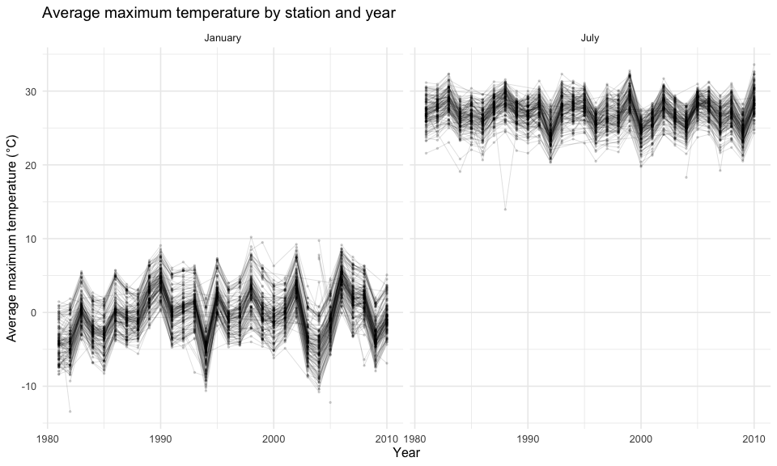
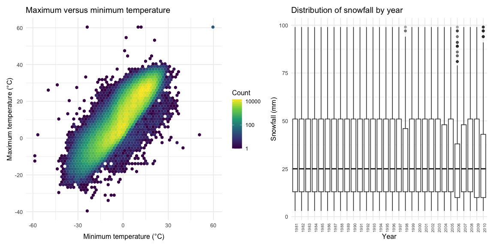
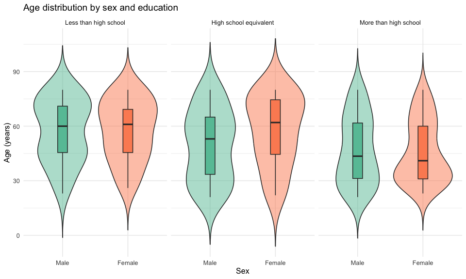
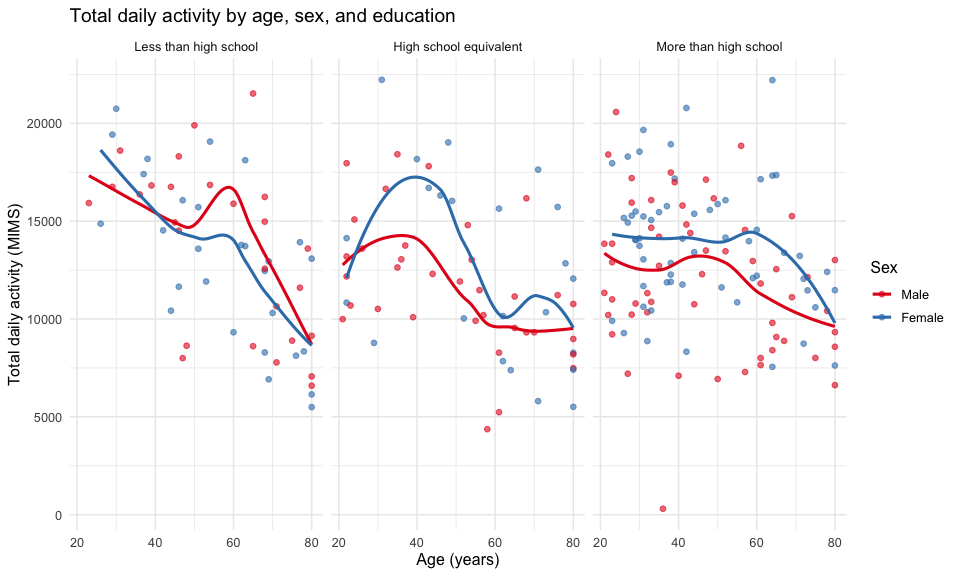
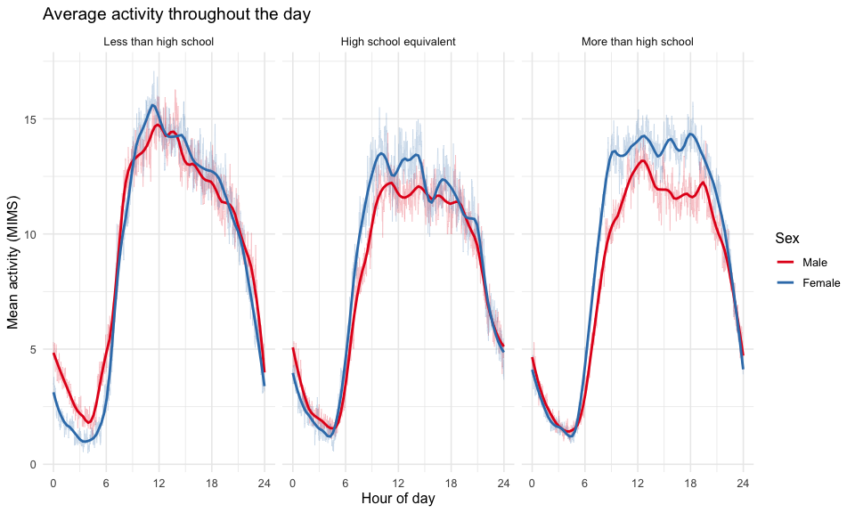
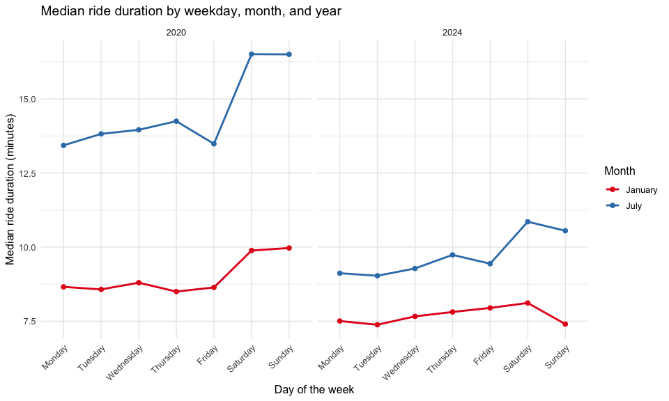
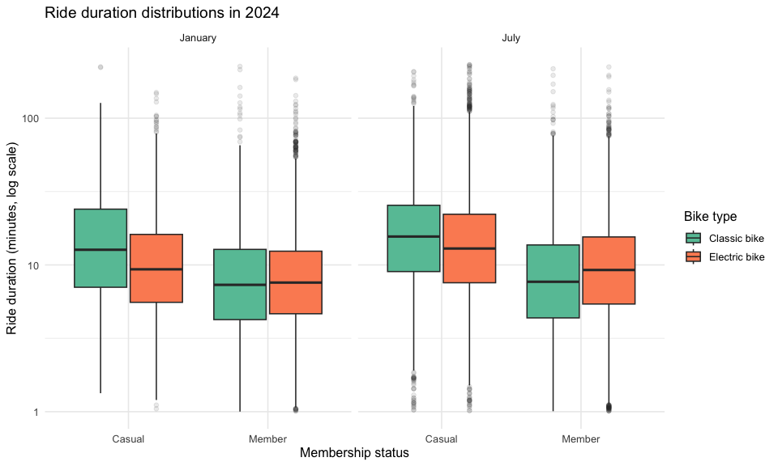

Homework 3
================
Songyao Wang

# Problem 1

``` r
data("ny_noaa")

noaa_missing =
  ny_noaa |>
  summarize(across(everything(), ~ mean(is.na(.x)))) |>
  pivot_longer(
    everything(),
    names_to = "variable",
    values_to = "missing_proportion"
  )

knitr::kable(noaa_missing, digits = 3)
```

| variable | missing_proportion |
|:---------|-------------------:|
| id       |              0.000 |
| date     |              0.000 |
| prcp     |              0.056 |
| snow     |              0.147 |
| snwd     |              0.228 |
| tmax     |              0.437 |
| tmin     |              0.437 |

The original dataset contains 2595176 observations and 7 variables. Each
row records weather measurements for a station on a particular date. Key
variables include station ID, date, precipitation, snowfall, snow depth,
and minimum and maximum temperature. The table above shows the
proportion of missing values for each variable.

``` r
noaa =
  ny_noaa |>
  mutate(
    year = as.integer(format(date, "%Y")),
    month = as.integer(format(date, "%m")),
    day = as.integer(format(date, "%d")),
    prcp = prcp / 10,
    tmax = as.numeric(tmax) / 10,
    tmin = as.numeric(tmin) / 10
  )

snowfall_counts =
  noaa |>
  filter(!is.na(snow)) |>
  count(snow, sort = TRUE) |>
  slice_head(n = 10)

knitr::kable(
  snowfall_counts,
  col.names = c("Snowfall (mm)", "Number of observations")
)
```

| Snowfall (mm) | Number of observations |
|--------------:|-----------------------:|
|             0 |                2008508 |
|            25 |                  31022 |
|            13 |                  23095 |
|            51 |                  18274 |
|            76 |                  10173 |
|             8 |                   9962 |
|             5 |                   9748 |
|            38 |                   9197 |
|             3 |                   8790 |
|           102 |                   6552 |

Precipitation is expressed in millimeters and temperature in degrees
Celsius. Snowfall and snow depth remain in millimeters. Zero snowfall is
common because most days have no measurable snowfall. Repeated positive
values may reflect measurements originally recorded in inches and
converted to millimeters.

``` r
station_temperature =
  noaa |>
  filter(month %in% c(1, 7)) |>
  group_by(id, year, month) |>
  summarize(
    mean_tmax = mean(tmax, na.rm = TRUE),
    .groups = "drop"
  ) |>
  filter(is.finite(mean_tmax)) |>
  mutate(
    month = factor(
      month,
      levels = c(1, 7),
      labels = c("January", "July")
    )
  )

ggplot(
  station_temperature,
  aes(x = year, y = mean_tmax, group = id)
) +
  geom_line(alpha = 0.15, linewidth = 0.3) +
  geom_point(alpha = 0.15, size = 0.5) +
  facet_wrap(~ month, nrow = 1) +
  labs(
    title = "Average maximum temperature by station and year",
    x = "Year",
    y = "Average maximum temperature (°C)"
  )
```

<!-- -->

``` r
temperature_plot =
  noaa |>
  filter(!is.na(tmin), !is.na(tmax)) |>
  ggplot(aes(x = tmin, y = tmax)) +
  geom_hex(bins = 60) +
  scale_fill_viridis_c(trans = "log10") +
  labs(
    title = "Maximum versus minimum temperature",
    x = "Minimum temperature (°C)",
    y = "Maximum temperature (°C)",
    fill = "Count"
  )

snowfall_plot =
  noaa |>
  filter(snow > 0, snow < 100) |>
  ggplot(aes(x = factor(year), y = snow)) +
  geom_boxplot(outlier.alpha = 0.1) +
  labs(
    title = "Distribution of snowfall by year",
    x = "Year",
    y = "Snowfall (mm)"
  ) +
  theme(
    axis.text.x = element_text(
      angle = 90,
      hjust = 1,
      size = 7
    )
  )

temperature_plot + snowfall_plot
```

<!-- -->

# Problem 2

``` r
nhanes_covar =
  read_csv(
    "data/nhanes_covar.csv",
    skip = 4,
    na = c("", "NA", ".")
  ) |>
  clean_names() |>
  drop_na() |>
  filter(age >= 21) |>
  mutate(
    sex = factor(
      sex,
      levels = c(1, 2),
      labels = c("Male", "Female")
    ),
    education = factor(
      education,
      levels = c(1, 2, 3),
      labels = c(
        "Less than high school",
        "High school equivalent",
        "More than high school"
      )
    )
  )

nhanes_accel =
  read_csv("data/nhanes_accel.csv") |>
  clean_names() |>
  pivot_longer(
    cols = starts_with("min"),
    names_to = "minute",
    names_prefix = "min",
    names_transform = list(minute = as.integer),
    values_to = "mims"
  )

nhanes =
  inner_join(
    nhanes_covar,
    nhanes_accel,
    by = "seqn"
  ) |>
  mutate(hour = (minute - 1) / 60)
```

After excluding participants younger than 21 years and those with
missing demographic information, the dataset includes 228 participants.
Each row in the long dataset represents one participant’s activity
during one minute. Demographic variables include sex, age, BMI, and
education.

``` r
education_sex_table =
  nhanes_covar |>
  count(education, sex) |>
  pivot_wider(
    names_from = sex,
    values_from = n,
    values_fill = 0
  )

knitr::kable(
  education_sex_table,
  col.names = c("Education", "Male", "Female"),
  caption = "Participant counts by education and sex"
)
```

| Education              | Male | Female |
|:-----------------------|-----:|-------:|
| Less than high school  |   27 |     28 |
| High school equivalent |   35 |     23 |
| More than high school  |   56 |     59 |

Participant counts by education and sex

``` r
ggplot(
  nhanes_covar,
  aes(x = sex, y = age, fill = sex)
) +
  geom_violin(alpha = 0.5, trim = FALSE) +
  geom_boxplot(width = 0.15, outlier.shape = NA) +
  facet_wrap(~ education, nrow = 1) +
  scale_fill_brewer(palette = "Set2") +
  labs(
    title = "Age distribution by sex and education",
    x = "Sex",
    y = "Age (years)"
  ) +
  theme(legend.position = "none")
```

<!-- -->

The sample contains 228 eligible participants. The group with more than
a high school education has the most participants. Men and women have
similar counts in the lowest and highest education categories, while the
high school equivalent category contains more men than women.

``` r
daily_activity =
  nhanes |>
  group_by(seqn, sex, age, bmi, education) |>
  summarize(
    observed_minutes = sum(!is.na(mims)),
    total_activity = if_else(
      observed_minutes == 1440L,
      sum(mims, na.rm = TRUE),
      NA_real_
    ),
    .groups = "drop"
  )

ggplot(
  daily_activity,
  aes(x = age, y = total_activity, color = sex)
) +
  geom_point(alpha = 0.6) +
  geom_smooth(method = "loess", se = FALSE) +
  facet_wrap(~ education, nrow = 1) +
  scale_color_brewer(palette = "Set1") +
  labs(
    title = "Total daily activity by age, sex, and education",
    x = "Age (years)",
    y = "Total daily activity (MIMS)",
    color = "Sex"
  )
```

<!-- -->

``` r
activity_timecourse =
  nhanes |>
  group_by(education, sex, minute, hour) |>
  summarize(
    mean_mims = mean(mims, na.rm = TRUE),
    .groups = "drop"
  )

ggplot(
  activity_timecourse,
  aes(x = hour, y = mean_mims, color = sex)
) +
  geom_line(alpha = 0.25, linewidth = 0.3) +
  geom_smooth(
    method = "loess",
    span = 0.15,
    se = FALSE,
    linewidth = 1
  ) +
  facet_wrap(~ education, nrow = 1) +
  scale_x_continuous(
    breaks = seq(0, 24, 6),
    limits = c(0, 24)
  ) +
  scale_color_brewer(palette = "Set1") +
  labs(
    title = "Average activity throughout the day",
    x = "Hour of day",
    y = "Mean activity (MIMS)",
    color = "Sex"
  )
```

<!-- -->

# Problem 3

``` r
jan_2020 =
  read_csv("data/citibike/Jan 2020 Citi.csv") |>
  mutate(year = 2020L, month = "January")

july_2020 =
  read_csv("data/citibike/July 2020 Citi.csv") |>
  mutate(year = 2020L, month = "July")

jan_2024 =
  read_csv("data/citibike/Jan 2024 Citi.csv") |>
  mutate(year = 2024L, month = "January")

july_2024 =
  read_csv("data/citibike/July 2024 Citi.csv") |>
  mutate(year = 2024L, month = "July")

citibike =
  bind_rows(jan_2020, july_2020, jan_2024, july_2024) |>
  clean_names() |>
  mutate(
    year = factor(year),
    month = factor(month, levels = c("January", "July")),
    weekdays = factor(
      weekdays,
      levels = c(
        "Monday", "Tuesday", "Wednesday", "Thursday",
        "Friday", "Saturday", "Sunday"
      )
    ),
    member_casual = factor(
      member_casual,
      levels = c("casual", "member"),
      labels = c("Casual", "Member")
    ),
    rideable_type = factor(
      rideable_type,
      levels = c("classic_bike", "electric_bike"),
      labels = c("Classic bike", "Electric bike")
    )
  )

glimpse(citibike)
```

    ## Rows: 99,485
    ## Columns: 9
    ## $ ride_id            <chr> "4BE06CB33B037044", "26886E034974493B", "24DC56060E…
    ## $ rideable_type      <fct> Classic bike, Classic bike, Classic bike, Classic b…
    ## $ weekdays           <fct> Tuesday, Wednesday, Friday, Sunday, Friday, Sunday,…
    ## $ duration           <dbl> 15.333267, 5.309467, 9.691800, 6.996183, 2.849500, …
    ## $ start_station_name <chr> "Columbus Ave & W 95 St", "2 Ave & E 96 St", "Colum…
    ## $ end_station_name   <chr> "E 53 St & Madison Ave", "1 Ave & E 110 St", "Grand…
    ## $ member_casual      <fct> Member, Member, Member, Member, Member, Member, Mem…
    ## $ year               <fct> 2020, 2020, 2020, 2020, 2020, 2020, 2020, 2020, 202…
    ## $ month              <fct> January, January, January, January, January, Januar…

The combined dataset contains 99485 rides and 9 variables. Variables
include ride ID, bike type, day of the week, ride duration in minutes,
starting and ending station, membership status, year, and month. These
data are samples of rides, rather than all Citi Bike rides.

``` r
ride_counts =
  citibike |>
  count(year, month, member_casual) |>
  pivot_wider(
    names_from = member_casual,
    values_from = n,
    values_fill = 0
  ) |>
  arrange(year, month)

knitr::kable(
  ride_counts,
  col.names = c("Year", "Month", "Casual", "Member"),
  format.args = list(big.mark = ","),
  caption = "Number of sampled rides by year, month, and membership"
)
```

| Year | Month   | Casual | Member |
|:-----|:--------|-------:|-------:|
| 2020 | January |    984 | 11,436 |
| 2020 | July    |  5,637 | 15,411 |
| 2024 | January |  2,108 | 16,753 |
| 2024 | July    | 10,894 | 36,262 |

Number of sampled rides by year, month, and membership

Members account for more rides than casual riders in every year-month
combination. July has more rides than January in both years. The sample
also contains more rides in 2024 than in the corresponding months of
2020.

``` r
top_stations =
  citibike |>
  filter(year == "2024", month == "July") |>
  filter(!is.na(start_station_name)) |>
  count(start_station_name, sort = TRUE) |>
  slice_head(n = 5)

knitr::kable(
  top_stations,
  col.names = c("Starting station", "Number of rides"),
  caption = "Five most popular starting stations in July 2024"
)
```

| Starting station         | Number of rides |
|:-------------------------|----------------:|
| Pier 61 at Chelsea Piers |             163 |
| University Pl & E 14 St  |             155 |
| W 21 St & 6 Ave          |             152 |
| West St & Chambers St    |             150 |
| W 31 St & 7 Ave          |             146 |

Five most popular starting stations in July 2024

``` r
median_duration =
  citibike |>
  group_by(year, month, weekdays) |>
  summarize(
    median_duration = median(duration, na.rm = TRUE),
    .groups = "drop"
  )

ggplot(
  median_duration,
  aes(
    x = weekdays,
    y = median_duration,
    color = month,
    group = month
  )
) +
  geom_line(linewidth = 1) +
  geom_point(size = 2) +
  facet_wrap(~ year, nrow = 1) +
  scale_color_brewer(palette = "Set1") +
  labs(
    title = "Median ride duration by weekday, month, and year",
    x = "Day of the week",
    y = "Median ride duration (minutes)",
    color = "Month"
  ) +
  theme(
    axis.text.x = element_text(angle = 45, hjust = 1)
  )
```

<!-- -->

``` r
citibike |>
  filter(year == "2024") |>
  ggplot(
    aes(
      x = member_casual,
      y = duration,
      fill = rideable_type
    )
  ) +
  geom_boxplot(
    outlier.alpha = 0.1,
    position = position_dodge(width = 0.8)
  ) +
  facet_wrap(~ month, nrow = 1) +
  scale_y_log10() +
  scale_fill_brewer(palette = "Set2") +
  labs(
    title = "Ride duration distributions in 2024",
    x = "Membership status",
    y = "Ride duration (minutes, log scale)",
    fill = "Bike type"
  )
```

<!-- -->
